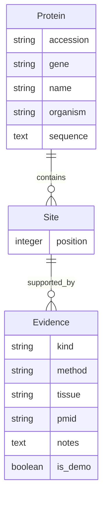

# 数据库配置与数据结构

默认数据库为 SQLite，保存在仓库根目录的 `db.sqlite3`。首次运行 `python manage.py migrate` 时依据迁移文件建表。SQLite 文件已由 `.gitignore` 排除；项目代码、迁移文件和数据模板应提交到 Git。无需另行安装数据库服务器。



`Protein` 用编号加物种唯一标识；`Site` 用蛋白加从 1 开始的位点唯一标识；`Evidence` 用位点、证据类型、方法、组织和 PMID 唯一标识。若提供序列，位点不能超过序列长度，而且必须对应半胱氨酸 `C`。证据类型为 `experimental` 或 `predicted`。管理员在 `/admin/` 维护数据，匿名访问只能查询和导出。

| 文件 | 作用 | 主要内容 |
| --- | --- | --- |
| `config/settings.py` | 数据库和应用设置 | SQLite 引擎、`DJANGO_DB_PATH`、密钥、主机、已安装应用 |
| `.env.example` | 本地配置模板 | `DJANGO_DB_PATH`、`DJANGO_SECRET_KEY`、`DJANGO_DEBUG`、`DJANGO_ALLOWED_HOSTS` |
| `palmitoylation/models.py` | 数据模型 | `Protein`、`Site`、`Evidence`、唯一约束和位点验证 |
| `palmitoylation/migrations/0001_initial.py` | 建表迁移 | 三张业务表及约束 |
| `palmitoylation/admin.py` | 数据管理 | 后台列表、搜索和编辑入口 |
| `palmitoylation/management/commands/import_records.py` | CSV 导入 | 整批校验、事务回滚、重复导入更新 |
| `data/template.csv` | 数据格式模板 | 导入所需列名 |

## 环境变量

复制 `.env.example` 为 `.env` 后可修改：

- `DJANGO_DB_PATH=db.sqlite3`：SQLite 文件路径，相对路径以仓库根目录为基准；也可填绝对路径。
- `DJANGO_SECRET_KEY`：本地开发使用默认占位符；生产部署前设置私有随机值。
- `DJANGO_DEBUG=true`：本地调试。设为 `false` 时必须提供私有密钥。
- `DJANGO_ALLOWED_HOSTS`：逗号分隔的主机，默认支持 localhost 和 GitHub Codespaces 的 `.app.github.dev` 域名。

真实环境变量优先于 `.env`。程序仅解析上述四个键，不执行 `.env` 中的 shell 命令。不要提交 `.env` 或 SQLite 数据文件。

## 初始化、备份与导入

```bash
python manage.py migrate
python manage.py createsuperuser
python manage.py import_records data/your_records.csv
```

导入文件须为 UTF-8 CSV，表头与 `data/template.csv` 一致。必填 `accession`、`gene`、`name`、`organism`、`position`、`kind`。`sequence` 可空；`method`、`tissue`、`pmid`、`notes` 可空，PMID 有值时只能为数字。整个文件在一个事务里处理，任何行错误都会回滚所有导入。演示文件须显式加 `--demo` 标记。

备份时先停止网站，再复制 `db.sqlite3`；恢复时同样在网站停止时替换文件。若使用自定义 `DJANGO_DB_PATH`，备份对应路径。也可运行 `python manage.py dumpdata palmitoylation --indent 2 > backup.json` 做逻辑导出；JSON 文件可能包含研究数据，应自行妥善保管。
